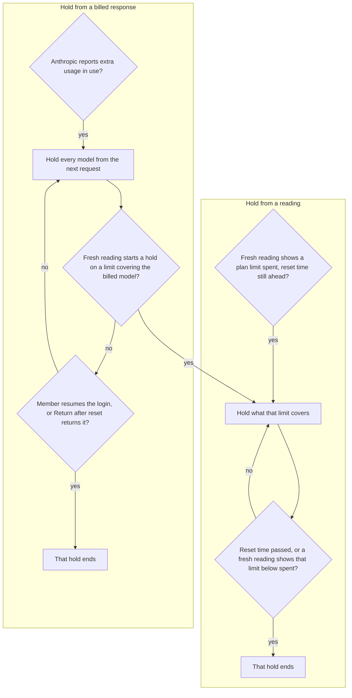

# Claude Extra Usage Display and Switch - Plan

## Goal Capsule

- **Objective:** A member who routes their own Claude subscription login through the router can see on the dashboard whether Anthropic will bill requests past a plan limit, and can have the router stop sending that login the requests a spent limit covers once the router learns the limit is spent.
- **Means:** Show the extra-usage state on each Claude login's row, warn while it is on, and give the row one router-side switch (Key Decisions).
- **Product authority:** Key Decisions that carry a label are the operator's choices from the 2026-11-16 brainstorm; the one without a label is this plan's own proposal.
- **Open blockers:** None.

---

## Product Contract

### Summary

Each Claude login on the Accounts page shows whether extra usage is on at Anthropic, and warns while it is on.
One switch per login, off until the member turns it on, makes the router stop sending the login the requests covered by a plan limit that a usage reading shows spent (a hold), and use the login again when that limit resets.
The switch replaces "Pause on extra usage" and keeps its stop after a billed response, which ends as that pause ends today unless a reading names the spent limit.
The router never changes the setting at Anthropic.

### Problem Frame

Extra usage is a setting on a Claude subscriber's own Anthropic account, which Anthropic now calls usage credits.
With it on, Anthropic keeps serving requests after a plan limit is spent and bills them.
A Claude login in this plan is an account of provider `anthropic`: in practice a Claude subscription signed in by OAuth, and the set of accounts "Pause on extra usage" is offered on today.

House of Vibe members run the router on their own machine with their own logins.
The operator expects most of them to sign in with a subscription and hold no API key, so extra usage on that login is the likeliest way a member gets a bill they did not expect.

The router shows almost nothing about it.
Anthropic's usage reading reports extra usage in one of two forms, and the Accounts page draws its "Extra usage spent" meter for only one of them, and only while that form reports extra usage on.
No row says whether extra usage is on or off.
A reading older than 10 minutes is dropped with no marker, so a row with no meter can mean off, not known, or the other form.
The add-account flow has no text about it, and `docs/agent-setup.md` tells a setup agent to ask before "paid usage or overages" without a step that checks a login's setting.
The only other sign a member may get is Claude Code's own usage-credits prompt, which a repo write-up records for Fable models (the tier above Opus, with its own weekly limit) in Claude Code 2.1.289.

What the router does with a login at a spent limit depends on the limit.
Once a fresh reading shows the 5-hour or weekly limit spent, the router stops using the login for every model, whatever the extra-usage setting.
A spent per-model weekly limit is different.
On ordinary routes a default install ignores per-model limits when it picks a login.
An install that enforces them, and any route that names a login, skips a Claude login at a spent per-model limit only when the reading says extra usage is unavailable, or shortly after Anthropic has refused that model for lack of credits.
A member with extra usage on is therefore still sent requests for a model whose limit is spent, and Anthropic would bill them.

The "Pause on extra usage" switch does not prevent that bill.
It acts only after Anthropic has answered a request and reported extra usage in use, so that request is already billed.
It then pauses the whole login and records no reset time for the pause.
The login comes back only if a second switch, "Return after reset", is on and a separate reset time the router stores for the login has passed; otherwise the member resumes it by hand.

This billing path is a reading of the code, not an observation; Dependencies / Assumptions says what was and was not seen.

### Actors

- A1. Member: runs the router on their own machine with their own Claude login, and owns the extra-usage setting at Anthropic.
- A2. Setup agent: the member's coding agent, following `docs/agent-setup.md` to install the router and add logins.
- A3. Router: reads each login's usage, picks a login for each request, and applies the switch.
- A4. Anthropic: holds the extra-usage setting, reports it in usage readings and response headers, and bills extra usage.

### Key Decisions

- **The work is for a House of Vibe member on their own install.** (session-settled: user-directed — chosen over a spend limit for the operator's own fleet: the operator named members, not their own setup, as the people at risk of an unexpected bill.) Governs R7, R8, R9.
- **Extra usage on the signed-in login comes before a separately added paid key.** (session-settled: user-directed — chosen over starting with paid keys: the operator expects most members to use a subscription login and hold no API key.) Governs R1, R10.
- **The router shows the state, warns while it is on, and lets the member turn its use off.** (session-settled: user-directed — chosen over showing the state and changing no routing: the operator asked for the control to be built into the router.) Governs R1, R6, R10, R12. Conflict call-out: PR #445 built a per-login usage cap and PR #451 reverted it because its premise was wrong and it only held capacity back; this switch is opt-in, acts only at a spent limit, and never holds on a missing reading (R10, R12, R20).
- **The switch is router-side; the setting at Anthropic stays as the member left it.** (session-settled: user-approved — chosen over changing the setting through Anthropic's unpublished account endpoints: Anthropic documents only its own settings page as the control, and the endpoints cannot be tested.) Governs R2, R5, R25.
- **Nothing stops by default.** (session-settled: user-approved — chosen over holding a login at a spent limit unless the member opts out: "warn when enabled, allow them to disable" was read as today's behaviour until the member acts.) Governs R10, R26.
- **One switch replaces "Pause on extra usage".** (session-settled: user-approved — chosen over a second switch beside it: one control for one worry, and the old switch acts only after a billed response.) Governs R16, R27, R28, R30.
- **A hold tied to a limit comes back at that limit's reset with no manual step.** (session-settled: user-approved — chosen over a pause the member must end by hand: a member should not have to remember to turn a login back on.) Governs R14.
- **The switch is best effort and says so.** (session-settled: user-approved — chosen over promising no billed requests: the router learns of extra usage only from usage readings and Anthropic's responses.) Governs R20, R24.
- **ChatGPT logins, separately added paid keys and a dollar cap are left out.** (session-settled: user-approved — chosen over covering every paid path in one plan: the login's own extra usage is the case the operator ranked first.)
- **A reading releases or narrows a hold only when it names the limit, and the router adds no timed release of its own to a stop after a billed response.** An early release bills again, so this opt-in switch departs from the short timed release in `docs/solutions/rate-limit-scope-and-duration.md`. Governs R15, R17, R18, R19, R22.

### Requirements

**Showing the state**

- R1. The Accounts-page row of each Claude login shows whether extra usage is on, off or not known at Anthropic.
- R2. The state comes only from the usage readings and responses the router already receives, in either form Anthropic's reading takes.
- R3. A missing, failed or out-of-date reading shows as not known, never as off.
- R4. A reported state the router cannot place as on or off also shows as not known.
- R5. The row links to Anthropic's usage settings page, where the member changes the setting.

**Warning**

- R6. While a login's extra usage reads on, its row warns that Anthropic bills requests past a spent plan limit, and says whether the switch is on.
- R7. `docs/agent-setup.md` has the setup agent read each Claude login's extra-usage state after sign-in.
- R8. When that state is on, the setup agent tells the member in one plain sentence that requests past a plan limit are billed, and turns the switch on only at the member's yes.
- R9. When that state is not yet known, the setup agent says so, per R3, and points the member to the login's row on the Accounts page.

**The switch**

- R10. Each Claude login has one switch that tells the router not to use extra usage on that login, off by default.
- R11. The switch is offered and acts the same whatever the extra-usage state reads, because the state can be out of date or not known.
- R12. With the switch on, a fresh usage reading that shows a plan limit spent, with its reset time still ahead, starts a hold: the router sends the login no request that limit covers.
- R13. A hold applies on every path that can pick the login, including a route that names it and a default install, whose ordinary routing otherwise ignores per-model limits.
- R14. A hold from a reading lasts until the reset time that reading gave for the limit, with no manual step.
- R15. Before that reset, a later fresh reading ends a hold from a reading only when it shows the same limit below spent.
- R16. With the switch on, a response from Anthropic that reports extra usage in use starts a hold on every model from the next request, without waiting for a usage reading.
- R17. A hold from a billed response ends the way a "Pause on extra usage" pause ends today: the member resumes the login, or "Return after reset" returns it.
- R18. A fresh reading ends a hold from a billed response only when it starts a hold (R12) on a limit that covers the billed model, and that hold takes its place.
- R19. Holds on a login are independent: each ends by its own rule, and a request that no hold covers is routed as it is with the switch off.
- R20. A missing or out-of-date reading alone never starts a hold.
- R21. Turning the switch off ends at once every hold on the login.
- R22. The member's resume action ends a hold from a billed response only; a hold from a reading ends by R14, R15 or R21.
- R23. The row shows each hold: what is held, why, and how it ends.
- R24. The switch's own text says it is best effort: a request can be billed before the router learns that a limit is spent.
- R25. The router never changes the extra-usage setting at Anthropic.

**Existing installs**

- R26. With the switch off, routing and client responses for the login are the same as today.
- R27. "Pause on extra usage" no longer appears on the dashboard.
- R28. Every account that had "Pause on extra usage" on has the new switch on after the upgrade.
- R29. A login that had "Pause on extra usage" on and is paused for extra usage at the upgrade is held from a billed response after it.
- R30. An API client that sets the old switch through `POST /api/accounts/:id/auto-pause-on-overage` keeps working for every account that route accepts today, and sets the new switch.

Both halves run at once while the switch is on (R19), and turning the switch off ends every hold in the diagram (R21).

### Key Flows

- F1. A member finds out extra usage is on
  - **Trigger:** A usage reading for a Claude login reports extra usage on.
  - **Actors:** A4, A3, A1
  - **Steps:** The row shows "on", the warning and the link to Anthropic's settings; the member turns the switch on, changes the setting at Anthropic, or leaves both as they are.
  - **Covered by:** R1, R2, R3, R4, R5, R6, R10
- F2. A reading holds a login and returns it
  - **Trigger:** With the switch on, a fresh reading shows a plan limit spent.
  - **Actors:** A3, A4, A1
  - **Steps:** The router stops sending the login the requests that limit covers; another login takes them, or the client gets the router's existing no-capacity refusal; the row shows the hold and its reset time; at the reset the router uses the login again.
  - **Covered by:** R11, R12, R13, R14, R15, R23
- F3. A billed response stops a login
  - **Trigger:** With the switch on, Anthropic answers a request and reports extra usage in use.
  - **Actors:** A4, A3, A1
  - **Steps:** That request is billed; the router sends the login nothing from the next request; the row shows the hold and how it ends; a fresh reading that names a spent limit covering the billed model turns it into a hold from a reading (F2); otherwise the member resumes the login or "Return after reset" returns it.
  - **Covered by:** R16, R17, R18, R23
- F4. A setup agent adds a Claude login
  - **Trigger:** The setup agent signs a Claude login in while following `docs/agent-setup.md`.
  - **Actors:** A2, A1, A3
  - **Steps:** The agent reads the login's extra-usage state; when it is on, the agent tells the member, asks whether to turn the switch on, and turns it on at a yes; when it is not yet known, the agent says so and points to the login's row.
  - **Covered by:** R7, R8, R9, R10

### Acceptance Examples

- AE1. **Covers R1, R5, R6, R24.** Given a Claude login whose latest reading reports extra usage on and whose switch is off, when the member opens the Accounts page, then the row shows extra usage on, warns that Anthropic bills requests past a spent plan limit, says the switch is off, links to Anthropic's usage settings page, and the switch's text says a request can be billed before the router learns that a limit is spent.
- AE2. **Covers R1, R6, R11.** Given a login whose reading reports extra usage off, then the row shows off with no warning, and the switch is still offered.
- AE3. **Covers R2.** Given two logins whose readings report extra usage on, one in each form Anthropic's reading takes, then both rows show on and both warn.
- AE4. **Covers R3, R9.** Given a login added a moment ago with no usage reading yet, or one whose last reading is out of date, then the row shows "not known", and a setup agent reports the state as not yet known and points to the row.
- AE5. **Covers R4.** Given a login whose reading reports a state the router cannot place as on or off, then the row shows "not known", not off.
- AE6. **Covers R7, R8, R10.** Given a setup agent that has just signed in a Claude login, whose switch starts off and whose reading reports extra usage on, then the agent tells the member in one sentence that requests past a plan limit are billed and asks whether to turn the switch on; it turns the switch on when the member says yes and leaves it off otherwise.
- AE7. **Covers R12, R13, R23.** Given a default install with one Claude login, extra usage on, the switch on, and a fresh reading that shows the weekly Opus limit spent, when the member's client asks for an Opus model, then the router sends the login no Opus request and the client gets the same refusal as when no login has capacity for that model; a Sonnet request still goes to the login; the row shows the Opus hold, its reset time, and that turning the switch off ends it.
- AE8. **Covers R11.** Given AE7's login with extra usage reading off or not known, then the Opus hold applies all the same.
- AE9. **Covers R12.** Given a login whose fresh reading already shows the weekly Opus limit spent, when the member turns the switch on, then the next Opus request is not sent to the login.
- AE10. **Covers R12.** Given the switch on and a fresh reading that shows the weekly Opus limit spent but gives no reset time for it, or one already past, then no hold starts and Opus requests are routed as they are with the switch off.
- AE11. **Covers R26.** Given AE7's login with the switch off, then the Opus request goes to the login as it does today, and the row shows the warning.
- AE12. **Covers R12, R26.** Given a fresh reading that shows the 5-hour or weekly limit spent, then the router stops using the login for every model whether the switch is on or off.
- AE13. **Covers R14.** Given AE7's hold, when the Opus limit's reset time passes, then the next Opus request goes to the login with no manual step and with "Return after reset" off.
- AE14. **Covers R14.** Given AE7's hold, when the usage poll then fails for an hour, then the login still gets no Opus request until the reset time the last reading gave.
- AE15. **Covers R15.** Given AE7's hold, when a later fresh reading shows the weekly Opus limit below spent, then the hold ends; when a later reading omits the Opus limit or does not count it, then the hold stays.
- AE16. **Covers R12.** Given two Claude logins, with the switch on for the first and a fresh reading that shows its weekly Opus limit spent, then Opus requests go to the second login and the first still takes requests for other models.
- AE17. **Covers R16, R23.** Given one Claude login with the switch on and no reading that shows a limit spent, when Anthropic answers an Opus request and reports extra usage in use, then that request was billed, the router sends the login nothing from the next request on, the client gets the router's existing no-capacity refusal, and the row shows the hold and how it ends.
- AE18. **Covers R18.** Given AE17's hold, when the next fresh reading shows the weekly Opus limit spent, then the hold becomes an Opus-only hold that ends at that limit's reset, and the login takes requests for other models again.
- AE19. **Covers R18.** Given AE17's hold, when the next fresh reading shows no limit spent, then the login stays held for every model.
- AE20. **Covers R18.** Given AE17's hold, when the next fresh reading shows only the weekly Fable limit spent, then the login stays held for every model, Opus included.
- AE21. **Covers R17.** Given AE17's hold, when the member resumes the login while the Opus limit is still spent and no reading shows it, then the router uses the login again, and the next response that reports extra usage in use holds it again.
- AE22. **Covers R17.** Given AE17's hold, then with "Return after reset" off the login stays held until the member resumes it; with it on, the login returns once the reset time the router stores for the login has passed, as an extra-usage pause does today, whether or not the limit is still spent.
- AE23. **Covers R19, R22.** Given AE7's Opus hold, when Anthropic answers a Sonnet request and reports extra usage in use, then every model is held from the next request; when the member then resumes the login, Sonnet requests go to it again and the Opus hold stays until its reset.
- AE24. **Covers R21.** Given a login with a hold from a reading and a hold from a billed response, when the member turns the switch off, then both holds end at once and requests are routed as they are with the switch off.
- AE25. **Covers R12, R20, R21.** Given a member who turns the switch off and on again while the weekly Opus limit is still spent, then with a fresh reading that shows the limit spent the Opus hold starts again at once, and with no fresh reading no hold starts until a reading or a billed response arrives.
- AE26. **Covers R13.** Given a route that names a held login for a held model, then the client gets the refusal that route already gives for a login with no capacity, and the request is not sent to another login.
- AE27. **Covers R20.** Given the switch on, a usage poll that keeps failing, and no response reporting extra usage, then the router uses the login as it does with the switch off.
- AE28. **Covers R27, R28, R30.** Given an install where a login had "Pause on extra usage" on, when it upgrades, then the row no longer shows "Pause on extra usage" and the login has the new switch on, so a hold a reading starts now returns on its own at the limit's reset (AE13); a client that posts to the old route to turn the old switch off turns the new switch off, which now also ends every hold on the login (R21), something the old switch never did.
- AE29. **Covers R29.** Given a login that had "Pause on extra usage" on and was paused for extra usage before the upgrade, then after the upgrade it is still held and the row shows a hold from a billed response; the pause recorded no billed model, so no reading ends it (R18), and it ends as in AE22 or at once when the member turns the switch off.
- AE30. **Covers R26, R29.** Given a login paused for extra usage whose "Pause on extra usage" was off before the upgrade, then after the upgrade its switch is off and it stays paused as it does today, until the member resumes it or "Return after reset" returns it.

### Success Criteria

- On the operator's install, where no Claude login has extra usage on and the switch is off, routing and client responses do not change (R26).
- Against a mock upstream, after a reading shows a limit spent or a response reports extra usage in use, the router sends the login no further request that the resulting hold covers until that hold ends (R12, R14, R16, R17).

### Scope Boundaries

**Deferred for later**

- A line about extra usage in the add-account step.
- Anthropic's monthly extra-usage limit, or any spent amount beyond today's "Extra usage spent" meter.
- An alert the first time a login is billed for extra usage.
- A warning anywhere outside the dashboard and the setup guide; a member who never opens the dashboard sees nothing, which was accepted.
- ChatGPT logins and their "Use purchased credits" switch.
- Separately added paid keys.
- A dollar cap on paid use.
- A way to keep using a login past a spent 5-hour or weekly limit for a member who wants the paid usage.

**Outside this product's identity**

- Changing the extra-usage setting at Anthropic, including through Anthropic's unpublished account endpoints (per R25).

**Not built by this plan**

- Holding a login by default (per R10).
- Starting a hold only because a reading is missing or out of date (per R20).
- A new kind of request to Anthropic to learn the state (per R2).
- A cap below 100% of a limit; `account_window_caps` does not return.
- Any change to the install-wide `model_scoped_capacity_routing` mode or its default.
- Any change to what "Return after reset" does (per R17).
- Any change to Claude Code's own usage-credits prompt; a `credits_required` refusal from Anthropic still reaches the client.

### Dependencies / Assumptions

- The billing path is a reading of the code at `e2282b20`, not an observation. No Claude login on the operator's install has extra usage on, and no request there is recorded as extra usage (read on 2026-11-16). No member report of such a bill was found. Issue #450 and `docs/solutions/integration-issues/claude-code-fable-usage-credits-prompt-armed-by-proxied-responses.md` record 0 of 45 captured Fable responses carrying the header R16 depends on, counted by 2026-10-05.
- Not recorded: what a spent per-model limit looks like in a usage reading. `docs/solutions/validate-against-live-payloads.md` records that in the reading's list-of-limits form Anthropic marks only the binding limit active, whatever the percentages, and `CONCEPTS.md` "Binding limit" keeps inactive rows out of routing. A spent per-model limit may therefore not count as shown, most plainly when two limits are spent at once. R12 cannot act on a limit that is not shown; R16 is then the only stop, after a billed request, and that hold ends only as R17 says. If Anthropic's response does not report extra usage either, the switch stops nothing for that limit.
- Unchecked: whether Anthropic bills some clients as extra usage before any plan limit is spent, the premise of upstream issue tombii/better-ccflare#113. If it does, no reading explains the bill and the hold ends only as R17 says.
- A consequence of R14 and R28: a login migrated from "Pause on extra usage" can be billed in more reset cycles than today. One billed response used to stop it until the member resumed it or "Return after reset" returned it; a hold a reading ties to a limit now returns at that limit's reset, and the next cycle can bill again before the next stop.
- A consequence of R18: when two limits are spent at once and the reading counts one, the every-model hold gives way to a hold on the counted limit. The login can then return while the other limit is still spent, and the next billed response holds it again (R16).
- A fresh reading is one no older than the age the router already uses for capacity decisions, 3 minutes today against a 90-second poll.
- The reset time the router stores for a login is the earliest of three response-header values, capped at 24 hours, and names no limit. No hold in this plan ends on it, except through "Return after reset" as today (R17).
- Unverified: whether Anthropic's usage reading always carries an extra-usage field for a Claude login. R3 covers its absence.
- Unverified: how soon a login added while the router runs gets its first usage reading; no add-account path was found that starts the poll. R9 covers a reading that has not arrived.
- Member installs run the router without `scripts/ccflare-guard.mjs`. That script drops Anthropic's extra-usage header on the operator's production service only. On a member install the header reaches Claude Code, so its own usage-credits prompt can fire (a code reading).
- `AGENTS.md` prohibits scripted requests to Anthropic, and the operator's install has no login with extra usage on, so the on-state paths are verified against a mock upstream and recorded reading shapes only.
- The account row does not yet use the UI kit's switch row, notice or help popover; PR #852 moved the Agents, API Keys, Combos and Settings pages onto the kit.

### Outstanding Questions

**Resolve Before Planning**

None.

**Deferred to Planning**

- [Affects R12, R13][Technical] How a hold is evaluated beside the existing capacity checks on each path that can pick a login (ordinary routing, combos, forced routes, the session, drain and affinity strategy variants, reactive model-capacity markers), and whether any of PR #445's reverted machinery is worth reusing.
- [Affects R12, R18][Needs research] Whether a limit that Anthropic marks inactive at 100% with a reset time ahead can count as shown spent; the repo's rule today keeps inactive rows out of routing.
- [Affects R12, R14][Needs research] Whether a usage reading ever shows a limit spent with no reset time, or with one already past; R12 starts no hold from such a reading.
- [Affects R14, R15][Technical] How a hold from a reading is stored so that it outlasts the reading that set it.
- [Affects R18][Technical] Which reading counts as explaining a billed response: one taken after it, or one that was fresh when it arrived.
- [Affects R1, R3, R4, R6][Needs research] How each state Anthropic reports maps onto on, off and not known; recorded responses show two reasons for extra usage being unavailable, "disabled by the organization" and "out of credits", and R4 makes either read not known unless research places it. Also how old a reading may be before the row says not known: the dashboard drops a reading at 10 minutes and routing treats one as fresh for 3.
- [Affects R7, R8, R9][Technical] Which surface the setup agent reads the state from and sets the switch through, and how a newly added login gets its first reading; the refresh-usage handler is a lead.
- [Affects R28, R29, R30][Technical] Whether the stored setting is renamed or reused, and how an extra-usage pause that exists at the upgrade is shown as a hold. Turning the switch off through the old route now releases a held login (R21), which the old switch never did; planning decides whether that makes this a breaking release.
- [Affects R1, R10][Needs research] Whether an `anthropic` account that is not a subscription login can exist; its state would read not known (R3).
- [Affects R12, R16][Technical] Whether the client refusal names the switch; today a held login would read as `capacity_exhausted`, and `model_pool_exhausted` carries no per-account reason.
- [Affects R10, R24][Technical] The switch's label and help text; "Don't use extra usage on this login" is a working label.

### Sources / Research

**Repository**

- `packages/proxy/src/handlers/usage-throttling.ts` — `evaluateHardCapacity` excludes a login at a spent account-wide limit whatever the extra-usage state, and treats a spent per-model limit as hard for Anthropic only when `resolveCapacityOverageStatus` returns "unavailable"; a reading older than `DEFAULT_CAPACITY_SNAPSHOT_FRESHNESS_MS` (3 minutes) leaves the login eligible.
- `packages/proxy/src/handlers/account-selector.ts` — `evaluateCandidateCapacity` drops per-model blockers unless `model_scoped_capacity_routing` is `exhausted` or the route is forced; `getReactiveModelCapacityBlocker` holds a model back after an out-of-credits refusal on those paths; a forced route at a blocked login fails with `model_capacity_exhausted` or `account_capacity_exhausted`.
- `packages/config/src/index.ts` — `model_scoped_capacity_routing` defaults to `off`, and the usage poll defaults to 90 seconds.
- `packages/proxy/src/usage-collector.ts` — reads `anthropic-ratelimit-unified-overage-in-use` and, with the account's flag on, queues `pauseAccount(accountId, "overage")` after the response.
- `packages/database/src/repositories/account.repository.ts` — the pause writes `paused` and `pause_reason` only, with no reset time; `updateRateLimitMeta` writes the stored `rate_limit_reset`, or null.
- `packages/providers/src/providers/anthropic/rate-limit-reset.ts` — `parseAnthropicRateLimitResetAt` takes the earliest of `retry-after`, `x-ratelimit-reset` and `anthropic-ratelimit-unified-reset`, capped at 24 hours.
- `packages/load-balancer/src/strategies/peek-availability.ts`, `packages/load-balancer/src/strategies/index.ts` — a paused login returns only with `auto_fallback_enabled` on and a stored `rate_limit_reset` in the past, for pause reasons null, `overage` and `rate_limit_window`.
- `packages/providers/src/usage-fetcher.ts` — `ExtraUsage.is_enabled` and `UsageSpend.enabled` carry the state in the reading's two forms; the cache returns nothing after 10 minutes, and a failed fetch caches nothing.
- `packages/http-api/src/handlers/accounts.ts`, `packages/http-api/src/router.ts` — `GET /api/accounts` returns `usageData`, the full reading or null with no age marker; `POST /api/accounts/:id/auto-pause-on-overage` sets the old switch for any `anthropic` account.
- `packages/dashboard-web/src/components/accounts/AccountListItem.tsx`, `packages/dashboard-web/src/components/accounts/RateLimitProgress.tsx` — the "Pause on extra usage" switch, shown for provider `anthropic`, with its tooltip, and the "Extra usage spent" meter drawn only when `spend.enabled` is true.
- `packages/dashboard-web/src/components/ui/switch-row.tsx`, `packages/dashboard-web/src/components/ui/notice.tsx`, `packages/dashboard-web/src/components/ui/help-popover.tsx` — UI kit pieces the account row does not import.
- `packages/proxy/src/handlers/routing-terminal.ts` — the `pool_exhausted`, `model_pool_exhausted` and `route_unavailable` refusals and their retry hints.
- `docs/solutions/rate-limit-scope-and-duration.md` — a hold's scope, duration and evidence must name the same limit; Anthropic's hard status appears on per-model caps as well as account-wide ones, and the header never says which; a reset no evidence attributes takes a short timed release.
- `docs/solutions/validate-against-live-payloads.md` — only the binding limit in the reading's list of limits is marked active.
- `docs/solutions/integration-issues/claude-code-fable-usage-credits-prompt-armed-by-proxied-responses.md` — how Claude Code's usage-credits prompt is armed, and that the guard drops the header at the last hop.
- `docs/solutions/workflow-issues/verify-capacity-exhausted-provider-lane-fixes-against-a-mock-upstream.md` — verifying a capacity path without scripted Anthropic traffic.
- `docs/plans/2026-10-05-0117-feat-account-usage-window-cap-plan.md` — the superseded per-login cap from PR #445, with the reason it was reverted.
- `docs/agent-setup.md`, `README.md` — the setup agent's lines on asking before paid usage or overages.
- `docs/auto-fallback.md` — which pause reasons return after a reset.
- `CONCEPTS.md` — Extra usage, Credit drain, Binding limit.

**Issues and pull requests**

- Issue #450 and PR #451 — the revert of PR #445's cap, and the header drop at the guard.
- tombii/better-ccflare#113 — asks about detecting extra usage against subscription usage.
- tombii/better-ccflare#404 — an account down for about 14 hours after its extra-usage pool reached 100%.

**Anthropic**

- <https://support.claude.com/en/articles/12429409-manage-usage-credits-for-paid-claude-plans> — the setting is switched under Settings > Usage on claude.ai; no API, CLI flag, environment variable or settings key for it is documented.
- <https://code.claude.com/docs/en/model-config#fable-and-usage-credits> — Claude Code's `/usage-credits` command opens that settings page.
- <https://claude.ai/settings/usage> — the settings page R5 links to.
