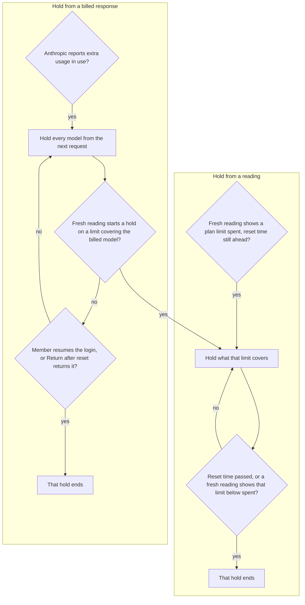
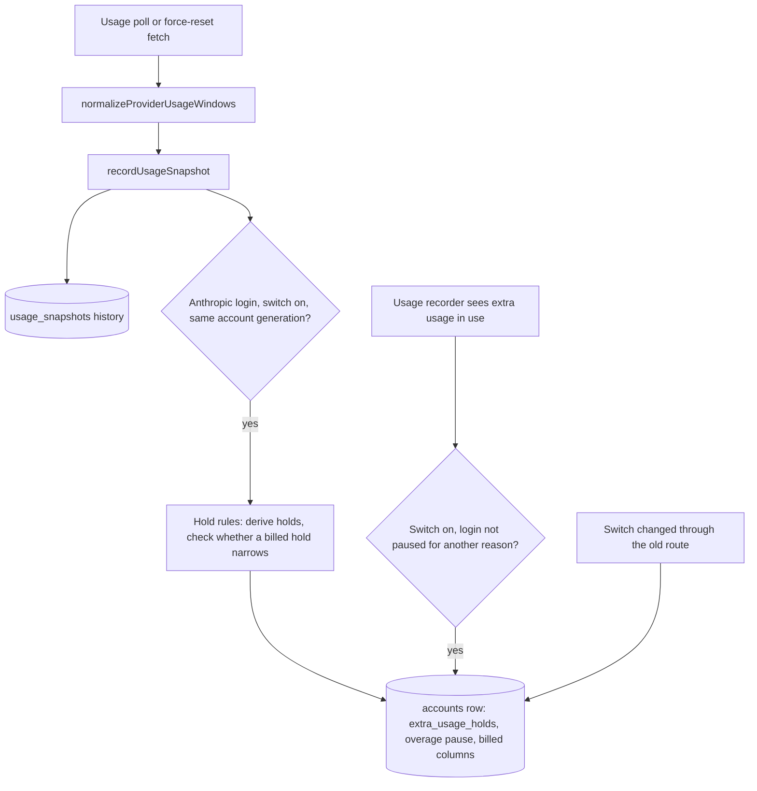
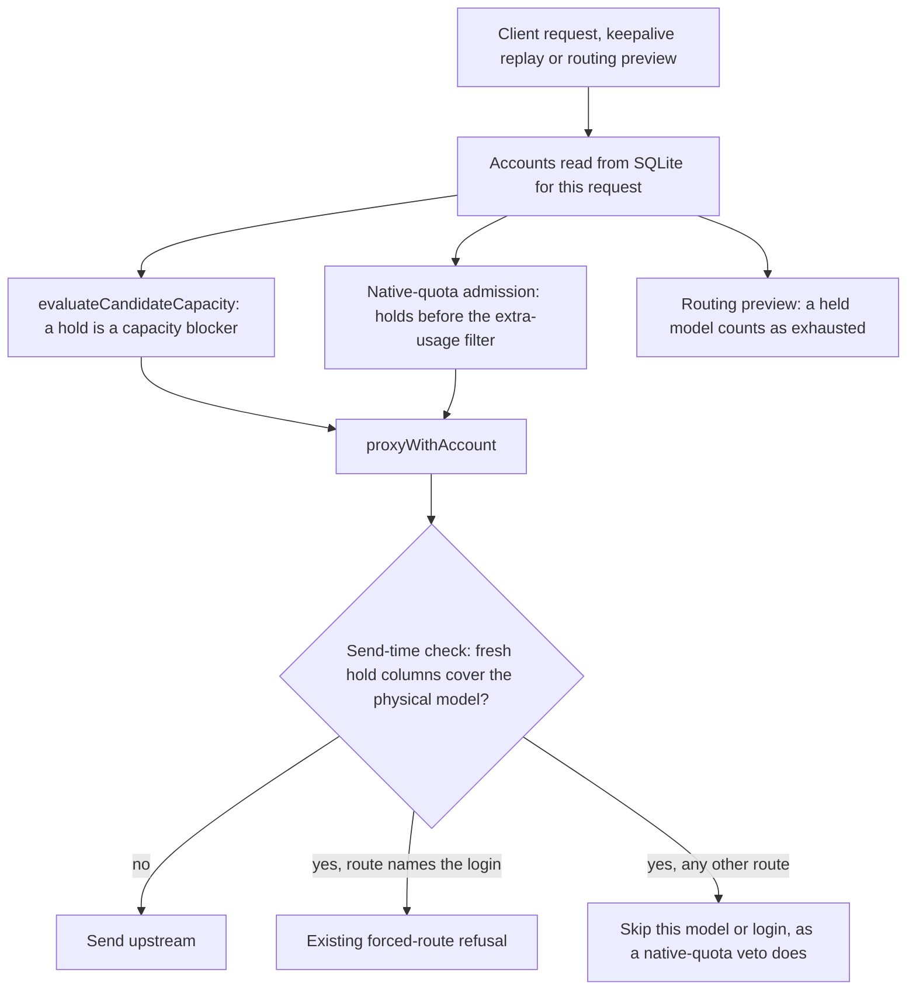
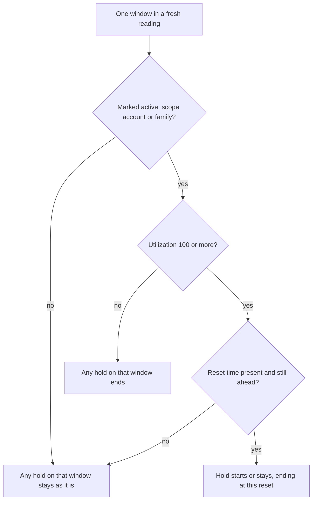
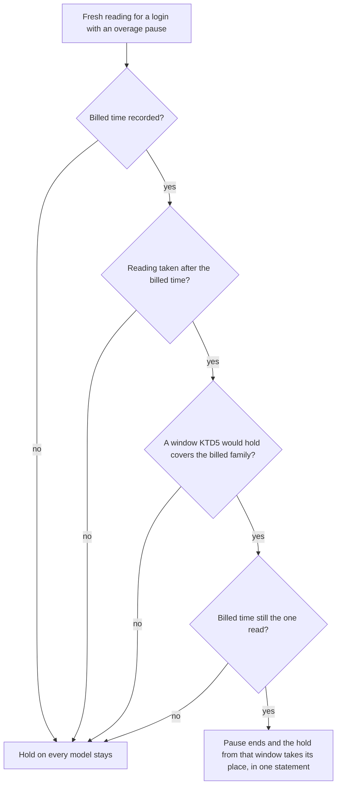

# Claude Extra Usage Display and Switch - Plan

## Goal Capsule

- **Objective:** A member who routes their own Claude subscription login through the router can see on the dashboard whether Anthropic will bill requests past a plan limit, and can have the router stop sending that login the requests a spent limit covers once the router learns the limit is spent.
- **Means:** One router-side switch per Claude login, built on the old switch's stored setting, whose holds are stored on the account and checked where the router picks a login and again just before each send (KTD1, KTD2, KTD11, KTD12).
- **Product authority:** Key Decisions that carry a label are the operator's choices from the 2026-11-16 brainstorm. The unlabelled Key Decision, R21, R29 and R12's "reset time still ahead" are the plan author's proposal. The operator answered the planning summary, which named those rules as the author's proposal, with "continue": a go-ahead to write this plan, not a choice between options. A KTD labelled `user-approved` either carries a labelled Key Decision into code or records a choice that summary put to the operator beside its alternative.
- **Technical authority:** The Planning Contract's KTDs, then the units. A unit that cannot meet a cited R or AE as written stops for the operator; it never edits the Product Contract to fit.
- **Execution profile:** One PR, built test-first in the order under Sequencing. Every test runs in-process against a stand-in for Anthropic; nothing sends a real Claude request (`AGENTS.md`).
- **Stop conditions:** Stop and ask the operator when a step would need a real request to an Anthropic account, when a change would alter routing or client responses for a login with the switch off (R26), or when U8 conflicts with the "accounts page redesign" session's work beyond a rebase.
- **Who finishes and ships:** The executing session opens the PR and merges it once the required checks pass. The schema change makes the deploy that ships it a full restart, which needs the operator's go at that time; merging does not deploy.
- **Open blockers:** None.

---

## Product Contract

### Summary

Each Claude login on the Accounts page shows whether extra usage is on at Anthropic, and warns while it is on.
One switch per login, off until the member turns it on, makes the router stop sending the login the requests covered by a plan limit that a usage reading shows spent (a hold), and use the login again when that limit resets.
The switch replaces "Pause on extra usage" and keeps its stop after a billed response, which ends as that pause ends today unless a reading names the spent limit.
The router never changes the setting at Anthropic.

The plan builds the switch on the old switch's stored setting, keeps each hold on the login's account record so it outlasts the reading that started it, and checks holds where the router picks a login and again just before each request is sent.
It also closes a gap beside the switch: a stop after a billed response is no longer lost when the router's write queue is full.

### Problem Frame

Extra usage is a setting on a Claude subscriber's own Anthropic account, which Anthropic now calls usage credits.
With it on, Anthropic keeps serving requests after a plan limit is spent and bills them.
A Claude login in this plan is an account of provider `anthropic`: in practice a Claude subscription signed in by OAuth, and the set of accounts "Pause on extra usage" is offered on today.

House of Vibe members run the router on their own machine with their own logins.
The operator expects most of them to sign in with a subscription and hold no API key, so extra usage on that login is the likeliest way a member gets a bill they did not expect.

The router shows almost nothing about it.
Anthropic's usage reading reports extra usage in one of two forms, and the Accounts page draws its "Extra usage spent" meter for only one of them, and only while that form reports extra usage on.
No row says whether extra usage is on or off.
A reading older than 10 minutes is dropped with no marker, so a row with no meter can mean off, not known, or the other form.
The add-account flow has no text about it, and `docs/agent-setup.md` tells a setup agent to ask before "paid usage or overages" without a step that checks a login's setting.
The only other sign a member may get is Claude Code's own usage-credits prompt, which a repo write-up records for Fable models (the tier above Opus, with its own weekly limit) in Claude Code 2.1.289.

What the router does with a login at a spent limit depends on the limit.
Once a fresh reading shows the 5-hour or weekly limit spent, the router stops using the login for every model, whatever the extra-usage setting.
A spent per-model weekly limit is different.
On ordinary routes a default install ignores per-model limits when it picks a login.
An install that enforces them, and any route that names a login, skips a Claude login at a spent per-model limit only when the reading says extra usage is unavailable, or shortly after Anthropic has refused that model for lack of credits.
A member with extra usage on is therefore still sent requests for a model whose limit is spent, and Anthropic would bill them.

The "Pause on extra usage" switch does not prevent that bill.
It acts only after Anthropic has answered a request and reported extra usage in use, so that request is already billed.
It then pauses the whole login and records no reset time for the pause.
The login comes back only if a second switch, "Return after reset", is on and a separate reset time the router stores for the login has passed; otherwise the member resumes it by hand.

This billing path is a reading of the code, not an observation; Dependencies / Assumptions says what was and was not seen.

### Actors

- A1. Member: runs the router on their own machine with their own Claude login, and owns the extra-usage setting at Anthropic.
- A2. Setup agent: the member's coding agent, following `docs/agent-setup.md` to install the router and add logins.
- A3. Router: reads each login's usage, picks a login for each request, and applies the switch.
- A4. Anthropic: holds the extra-usage setting, reports it in usage readings and response headers, and bills extra usage.

### Key Decisions

- **The work is for a House of Vibe member on their own install.** (session-settled: user-directed — chosen over a spend limit for the operator's own fleet: the operator named members, not their own setup, as the people at risk of an unexpected bill.) Governs R7, R8, R9.
- **Extra usage on the signed-in login comes before a separately added paid key.** (session-settled: user-directed — chosen over starting with paid keys: the operator expects most members to use a subscription login and hold no API key.) Governs R1, R10.
- **The router shows the state, warns while it is on, and lets the member turn its use off.** (session-settled: user-directed — chosen over showing the state and changing no routing: the operator asked for the control to be built into the router.) Governs R1, R6, R10, R12. Conflict call-out: PR #445 built a per-login usage cap and PR #451 reverted it because its premise was wrong and it only held capacity back; this switch is opt-in, acts only at a spent limit, and never holds on a missing reading (R10, R12, R20).
- **The switch is router-side; the setting at Anthropic stays as the member left it.** (session-settled: user-approved — chosen over changing the setting through Anthropic's unpublished account endpoints: Anthropic documents only its own settings page as the control, and the endpoints cannot be tested.) Governs R2, R5, R25.
- **Nothing stops by default.** (session-settled: user-approved — chosen over holding a login at a spent limit unless the member opts out: "warn when enabled, allow them to disable" was read as today's behaviour until the member acts.) Governs R10, R26.
- **One switch replaces "Pause on extra usage".** (session-settled: user-approved — chosen over a second switch beside it: one control for one worry, and the old switch acts only after a billed response.) Governs R16, R27, R28, R30.
- **A hold tied to a limit comes back at that limit's reset with no manual step.** (session-settled: user-approved — chosen over a pause the member must end by hand: a member should not have to remember to turn a login back on.) Governs R14.
- **The switch is best effort and says so.** (session-settled: user-approved — chosen over promising no billed requests: the router learns of extra usage only from usage readings and Anthropic's responses.) Governs R20, R24.
- **ChatGPT logins, separately added paid keys and a dollar cap are left out.** (session-settled: user-approved — chosen over covering every paid path in one plan: the login's own extra usage is the case the operator ranked first.)
- **A reading releases or narrows a hold only when it names the limit, and the router adds no timed release of its own to a stop after a billed response.** An early release bills again, so this opt-in switch departs from the short timed release in `docs/solutions/rate-limit-scope-and-duration.md`. Governs R15, R17, R18, R19, R22.

### Requirements

**Showing the state**

- R1. The Accounts-page row of each Claude login shows whether extra usage is on, off or not known at Anthropic.
- R2. The state comes only from the usage readings and responses the router already receives, in either form Anthropic's reading takes.
- R3. A missing, failed or out-of-date reading shows as not known, never as off.
- R4. A reported state the router cannot place as on or off also shows as not known.
- R5. The row links to Anthropic's usage settings page, where the member changes the setting.

**Warning**

- R6. While a login's extra usage reads on, its row warns that Anthropic bills requests past a spent plan limit, and says whether the switch is on.
- R7. `docs/agent-setup.md` has the setup agent read each Claude login's extra-usage state after sign-in.
- R8. When that state is on, the setup agent tells the member in one plain sentence that requests past a plan limit are billed, and turns the switch on only at the member's yes.
- R9. When that state is not yet known, the setup agent says so, per R3, and points the member to the login's row on the Accounts page.

**The switch**

- R10. Each Claude login has one switch that tells the router not to use extra usage on that login, off by default.
- R11. The switch is offered and acts the same whatever the extra-usage state reads, because the state can be out of date or not known.
- R12. With the switch on, a fresh usage reading that shows a plan limit spent, with its reset time still ahead, starts a hold: the router sends the login no request that limit covers.
- R13. A hold applies on every path that can pick the login, including a route that names it and a default install, whose ordinary routing otherwise ignores per-model limits.
- R14. A hold from a reading lasts until the reset time that reading gave for the limit, with no manual step.
- R15. Before that reset, a later fresh reading ends a hold from a reading only when it shows the same limit below spent.
- R16. With the switch on, a response from Anthropic that reports extra usage in use starts a hold on every model from the next request, without waiting for a usage reading.
- R17. A hold from a billed response ends the way a "Pause on extra usage" pause ends today: the member resumes the login, or "Return after reset" returns it.
- R18. A fresh reading ends a hold from a billed response only when it starts a hold (R12) on a limit that covers the billed model, and that hold takes its place.
- R19. Holds on a login are independent: each ends by its own rule, and a request that no hold covers is routed as it is with the switch off.
- R20. A missing or out-of-date reading alone never starts a hold.
- R21. Turning the switch off ends at once every hold on the login.
- R22. The member's resume action ends a hold from a billed response only; a hold from a reading ends by R14, R15 or R21.
- R23. The row shows each hold: what is held, why, and how it ends.
- R24. The switch's own text says it is best effort: a request can be billed before the router learns that a limit is spent.
- R25. The router never changes the extra-usage setting at Anthropic.

**Existing installs**

- R26. With the switch off, routing and client responses for the login are the same as today.
- R27. "Pause on extra usage" no longer appears on the dashboard.
- R28. Every account that had "Pause on extra usage" on has the new switch on after the upgrade.
- R29. A login that had "Pause on extra usage" on and is paused for extra usage at the upgrade is held from a billed response after it.
- R30. An API client that sets the old switch through `POST /api/accounts/:id/auto-pause-on-overage` keeps working for every account that route accepts today, and sets the new switch.

Both halves run at once while the switch is on (R19), and turning the switch off ends every hold in the diagram (R21).

### Key Flows

- F1. A member finds out extra usage is on
  - **Trigger:** A usage reading for a Claude login reports extra usage on.
  - **Actors:** A4, A3, A1
  - **Steps:** The row shows "on", the warning and the link to Anthropic's settings; the member turns the switch on, changes the setting at Anthropic, or leaves both as they are.
  - **Covered by:** R1, R2, R3, R4, R5, R6, R10
- F2. A reading holds a login and returns it
  - **Trigger:** With the switch on, a fresh reading shows a plan limit spent.
  - **Actors:** A3, A4, A1
  - **Steps:** The router stops sending the login the requests that limit covers; another login takes them, or the client gets the router's existing no-capacity refusal; the row shows the hold and its reset time; at the reset the router uses the login again.
  - **Covered by:** R11, R12, R13, R14, R15, R23
- F3. A billed response stops a login
  - **Trigger:** With the switch on, Anthropic answers a request and reports extra usage in use.
  - **Actors:** A4, A3, A1
  - **Steps:** That request is billed; the router sends the login nothing from the next request; the row shows the hold and how it ends; a fresh reading that names a spent limit covering the billed model turns it into a hold from a reading (F2); otherwise the member resumes the login or "Return after reset" returns it.
  - **Covered by:** R16, R17, R18, R23
- F4. A setup agent adds a Claude login
  - **Trigger:** The setup agent signs a Claude login in while following `docs/agent-setup.md`.
  - **Actors:** A2, A1, A3
  - **Steps:** The agent reads the login's extra-usage state; when it is on, the agent tells the member, asks whether to turn the switch on, and turns it on at a yes; when it is not yet known, the agent says so and points to the login's row.
  - **Covered by:** R7, R8, R9, R10

### Acceptance Examples

- AE1. **Covers R1, R5, R6, R24.** Given a Claude login whose latest reading reports extra usage on and whose switch is off, when the member opens the Accounts page, then the row shows extra usage on, warns that Anthropic bills requests past a spent plan limit, says the switch is off, links to Anthropic's usage settings page, and the switch's text says a request can be billed before the router learns that a limit is spent.
- AE2. **Covers R1, R6, R11.** Given a login whose reading reports extra usage off, then the row shows off with no warning, and the switch is still offered.
- AE3. **Covers R2.** Given two logins whose readings report extra usage on, one in each form Anthropic's reading takes, then both rows show on and both warn.
- AE4. **Covers R3, R9.** Given a login added a moment ago with no usage reading yet, or one whose last reading is out of date, then the row shows "not known", and a setup agent reports the state as not yet known and points to the row.
- AE5. **Covers R4.** Given a login whose reading reports a state the router cannot place as on or off, then the row shows "not known", not off.
- AE6. **Covers R7, R8, R10.** Given a setup agent that has just signed in a Claude login, whose switch starts off and whose reading reports extra usage on, then the agent tells the member in one sentence that requests past a plan limit are billed and asks whether to turn the switch on; it turns the switch on when the member says yes and leaves it off otherwise.
- AE7. **Covers R12, R13, R23.** Given a default install with one Claude login, extra usage on, the switch on, and a fresh reading that shows the weekly Opus limit spent, when the member's client asks for an Opus model, then the router sends the login no Opus request and the client gets the same refusal as when no login has capacity for that model; a Sonnet request still goes to the login; the row shows the Opus hold, its reset time, and that turning the switch off ends it.
- AE8. **Covers R11.** Given AE7's login with extra usage reading off or not known, then the Opus hold applies all the same.
- AE9. **Covers R12.** Given a login whose fresh reading already shows the weekly Opus limit spent, when the member turns the switch on, then the next Opus request is not sent to the login.
- AE10. **Covers R12.** Given the switch on and a fresh reading that shows the weekly Opus limit spent but gives no reset time for it, or one already past, then no hold starts and Opus requests are routed as they are with the switch off.
- AE11. **Covers R26.** Given AE7's login with the switch off, then the Opus request goes to the login as it does today, and the row shows the warning.
- AE12. **Covers R12, R26.** Given a fresh reading that shows the 5-hour or weekly limit spent, then the router stops using the login for every model whether the switch is on or off.
- AE13. **Covers R14.** Given AE7's hold, when the Opus limit's reset time passes, then the next Opus request goes to the login with no manual step and with "Return after reset" off.
- AE14. **Covers R14.** Given AE7's hold, when the usage poll then fails for an hour, then the login still gets no Opus request until the reset time the last reading gave.
- AE15. **Covers R15.** Given AE7's hold, when a later fresh reading shows the weekly Opus limit below spent, then the hold ends; when a later reading omits the Opus limit or does not count it, then the hold stays.
- AE16. **Covers R12.** Given two Claude logins, with the switch on for the first and a fresh reading that shows its weekly Opus limit spent, then Opus requests go to the second login and the first still takes requests for other models.
- AE17. **Covers R16, R23.** Given one Claude login with the switch on and no reading that shows a limit spent, when Anthropic answers an Opus request and reports extra usage in use, then that request was billed, the router sends the login nothing from the next request on, the client gets the router's existing no-capacity refusal, and the row shows the hold and how it ends.
- AE18. **Covers R18.** Given AE17's hold, when the next fresh reading shows the weekly Opus limit spent, then the hold becomes an Opus-only hold that ends at that limit's reset, and the login takes requests for other models again.
- AE19. **Covers R18.** Given AE17's hold, when the next fresh reading shows no limit spent, then the login stays held for every model.
- AE20. **Covers R18.** Given AE17's hold, when the next fresh reading shows only the weekly Fable limit spent, then the login stays held for every model, Opus included.
- AE21. **Covers R17.** Given AE17's hold, when the member resumes the login while the Opus limit is still spent and no reading shows it, then the router uses the login again, and the next response that reports extra usage in use holds it again.
- AE22. **Covers R17.** Given AE17's hold, then with "Return after reset" off the login stays held until the member resumes it; with it on, the login returns once the reset time the router stores for the login has passed, as an extra-usage pause does today, whether or not the limit is still spent.
- AE23. **Covers R19, R22.** Given AE7's Opus hold, when Anthropic answers a Sonnet request and reports extra usage in use, then every model is held from the next request; when the member then resumes the login, Sonnet requests go to it again and the Opus hold stays until its reset.
- AE24. **Covers R21.** Given a login with a hold from a reading and a hold from a billed response, when the member turns the switch off, then both holds end at once and requests are routed as they are with the switch off.
- AE25. **Covers R12, R20, R21.** Given a member who turns the switch off and on again while the weekly Opus limit is still spent, then with a fresh reading that shows the limit spent the Opus hold starts again at once, and with no fresh reading no hold starts until a reading or a billed response arrives.
- AE26. **Covers R13.** Given a route that names a held login for a held model, then the client gets the refusal that route already gives for a login with no capacity, and the request is not sent to another login.
- AE27. **Covers R20.** Given the switch on, a usage poll that keeps failing, and no response reporting extra usage, then the router uses the login as it does with the switch off.
- AE28. **Covers R27, R28, R30.** Given an install where a login had "Pause on extra usage" on, when it upgrades, then the row no longer shows "Pause on extra usage" and the login has the new switch on, so a hold a reading starts now returns on its own at the limit's reset (AE13); a client that posts to the old route to turn the old switch off turns the new switch off, which now also ends every hold on the login (R21), something the old switch never did.
- AE29. **Covers R29.** Given a login that had "Pause on extra usage" on and was paused for extra usage before the upgrade, then after the upgrade it is still held and the row shows a hold from a billed response; the pause recorded no billed model, so no reading ends it (R18), and it ends as in AE22 or at once when the member turns the switch off.
- AE30. **Covers R26, R29.** Given a login paused for extra usage whose "Pause on extra usage" was off before the upgrade, then after the upgrade its switch is off and it stays paused as it does today, until the member resumes it or "Return after reset" returns it.

### Success Criteria

- On the operator's install, where no Claude login has extra usage on and the switch is off, routing and client responses do not change (R26).
- Against a mock upstream, after a reading shows a limit spent or a response reports extra usage in use, the router sends the login no further request that the resulting hold covers until that hold ends (R12, R14, R16, R17).

### Scope Boundaries

**Deferred for later**

- A line about extra usage in the add-account step.
- Anthropic's monthly extra-usage limit, or any spent amount beyond today's "Extra usage spent" meter.
- An alert the first time a login is billed for extra usage.
- A warning anywhere outside the dashboard and the setup guide; a member who never opens the dashboard sees nothing, which was accepted.
- ChatGPT logins and their "Use purchased credits" switch.
- Separately added paid keys.
- A dollar cap on paid use.
- A way to keep using a login past a spent 5-hour or weekly limit for a member who wants the paid usage.

**Outside this product's identity**

- Changing the extra-usage setting at Anthropic, including through Anthropic's unpublished account endpoints (per R25).

**Not built by this plan**

- Holding a login by default (per R10).
- Starting a hold only because a reading is missing or out of date (per R20).
- A new kind of request to Anthropic to learn the state (per R2).
- A cap below 100% of a limit; `account_window_caps` does not return.
- Any change to the install-wide `model_scoped_capacity_routing` mode or its default.
- Any change to what "Return after reset" does (per R17).
- Any change to Claude Code's own usage-credits prompt; a `credits_required` refusal from Anthropic still reaches the client.
- Polling a login added while the router runs as soon as it is added; the setup guide asks for a first reading instead (KTD17). This would change if members report rows stuck at "not known" after adding a login.
- A client refusal that names the switch; the client gets the existing no-capacity refusal and the row says why. This would change if members read those refusals as outages.
- Correcting for a host clock that disagrees with Anthropic's reset times; a hold ends by the host clock. This would change if a hold is seen ending more than one poll interval early or late.
- A per-model hold for a model outside the families `getModelFamily` knows; only an account-wide hold or a hold from a billed response covers such a model. This would change if Anthropic adds a per-model limit for a family the router does not know.
- An automatic return for a hold from a billed response on a login reached only by a route that names it; "Return after reset" runs when the router picks among logins, so such a login waits for the member's resume, as today. This would change if a member who routes by name reports a login left held.

### Dependencies / Assumptions

- The billing path is a reading of the code at `e2282b20`, not an observation. No Claude login on the operator's install has extra usage on, and no request there is recorded as extra usage (read on 2026-11-16). No member report of such a bill was found. Issue #450 and `docs/solutions/integration-issues/claude-code-fable-usage-credits-prompt-armed-by-proxied-responses.md` record 0 of 45 captured Fable responses carrying the header R16 depends on, counted by 2026-10-05.
- Not recorded: what a spent per-model limit looks like in a usage reading. `docs/solutions/validate-against-live-payloads.md` records that in the reading's list-of-limits form Anthropic marks only the binding limit active, whatever the percentages, and `CONCEPTS.md` "Binding limit" keeps inactive rows out of routing. A spent per-model limit may therefore not count as shown, most plainly when two limits are spent at once. R12 cannot act on a limit that is not shown; R16 is then the only stop, after a billed request, and that hold ends only as R17 says. If Anthropic's response does not report extra usage either, the switch stops nothing for that limit.
- Unchecked: whether Anthropic bills some clients as extra usage before any plan limit is spent, the premise of upstream issue tombii/better-ccflare#113. If it does, no reading explains the bill and the hold ends only as R17 says.
- A consequence of R14 and R28: a login migrated from "Pause on extra usage" can be billed in more reset cycles than today. One billed response used to stop it until the member resumed it or "Return after reset" returned it; a hold a reading ties to a limit now returns at that limit's reset, and the next cycle can bill again before the next stop.
- A consequence of R18: when two limits are spent at once and the reading counts one, the every-model hold gives way to a hold on the counted limit. The login can then return while the other limit is still spent, and the next billed response holds it again (R16).
- A fresh reading is one no older than the age the router already uses for capacity decisions, 3 minutes today against a 90-second poll.
- The reset time the router stores for a login is the earliest of three response-header values, capped at 24 hours, and names no limit. No hold in this plan ends on it, except through "Return after reset" as today (R17).
- Unverified: whether Anthropic's usage reading always carries an extra-usage field for a Claude login. R3 covers its absence.
- Unverified: how soon a login added while the router runs gets its first usage reading; no add-account path was found that starts the poll. R9 covers a reading that has not arrived.
- Member installs run the router without `scripts/ccflare-guard.mjs`. That script drops Anthropic's extra-usage header on the operator's production service only. On a member install the header reaches Claude Code, so its own usage-credits prompt can fire (a code reading).
- `AGENTS.md` prohibits scripted requests to Anthropic, and the operator's install has no login with extra usage on, so the on-state paths are verified against a mock upstream and recorded reading shapes only.
- The account row does not yet use the UI kit's switch row, notice or help popover; PR #852 moved the Agents, API Keys, Combos and Settings pages onto the kit.

### Outstanding Questions

**Resolve Before Planning**

None.

**Deferred to Planning**

The Planning Contract answers all eleven:

- How a hold is checked on each path, and whether PR #445's machinery helps: KTD11 and KTD12; nothing from #445 is reused.
- A limit Anthropic marks inactive at 100%: KTD5, it starts no hold.
- A spent limit with no reset time or a past one: KTD5, no hold; U2 tests it on edited reading shapes.
- How a hold from a reading is stored: KTD2.
- Which reading explains a billed response: KTD8, one taken after it.
- How Anthropic's states map to on, off and not known, and how old a reading may be: KTD14.
- The setup agent's surface and a new login's first reading: KTD15 and KTD17.
- Renaming or reusing the setting, the pause that exists at the upgrade, and whether the release is breaking: KTD1, KTD3 and KTD16.
- An `anthropic` account that is not a subscription login: KTD14, it reads not known.
- Whether the client refusal names the switch: Scope Boundaries, not built.
- The switch's label and help text: U8.

### Sources / Research

**Repository**

- `packages/proxy/src/handlers/usage-throttling.ts` — `evaluateHardCapacity` excludes a login at a spent account-wide limit whatever the extra-usage state, and treats a spent per-model limit as hard for Anthropic only when `resolveCapacityOverageStatus` returns "unavailable"; a reading older than `DEFAULT_CAPACITY_SNAPSHOT_FRESHNESS_MS` (3 minutes) leaves the login eligible.
- `packages/proxy/src/handlers/account-selector.ts` — `evaluateCandidateCapacity` drops per-model blockers unless `model_scoped_capacity_routing` is `exhausted` or the route is forced; `getReactiveModelCapacityBlocker` holds a model back after an out-of-credits refusal on those paths; a forced route at a blocked login fails with `model_capacity_exhausted` or `account_capacity_exhausted`.
- `packages/config/src/index.ts` — `model_scoped_capacity_routing` defaults to `off`, and the usage poll defaults to 90 seconds.
- `packages/proxy/src/usage-collector.ts` — reads `anthropic-ratelimit-unified-overage-in-use` and, with the account's flag on, queues `pauseAccount(accountId, "overage")` after the response.
- `packages/database/src/repositories/account.repository.ts` — the pause writes `paused` and `pause_reason` only, with no reset time; `updateRateLimitMeta` writes the stored `rate_limit_reset`, or null.
- `packages/providers/src/providers/anthropic/rate-limit-reset.ts` — `parseAnthropicRateLimitResetAt` takes the earliest of `retry-after`, `x-ratelimit-reset` and `anthropic-ratelimit-unified-reset`, capped at 24 hours.
- `packages/load-balancer/src/strategies/peek-availability.ts`, `packages/load-balancer/src/strategies/index.ts` — a paused login returns only with `auto_fallback_enabled` on and a stored `rate_limit_reset` in the past, for pause reasons null, `overage` and `rate_limit_window`.
- `packages/providers/src/usage-fetcher.ts` — `ExtraUsage.is_enabled` and `UsageSpend.enabled` carry the state in the reading's two forms; the cache returns nothing after 10 minutes, and a failed fetch caches nothing.
- `packages/http-api/src/handlers/accounts.ts`, `packages/http-api/src/router.ts` — `GET /api/accounts` returns `usageData`, the full reading or null with no age marker; `POST /api/accounts/:id/auto-pause-on-overage` sets the old switch for any `anthropic` account.
- `packages/dashboard-web/src/components/accounts/AccountListItem.tsx`, `packages/dashboard-web/src/components/accounts/RateLimitProgress.tsx` — the "Pause on extra usage" switch, shown for provider `anthropic`, with its tooltip, and the "Extra usage spent" meter drawn only when `spend.enabled` is true.
- `packages/dashboard-web/src/components/ui/switch-row.tsx`, `packages/dashboard-web/src/components/ui/notice.tsx`, `packages/dashboard-web/src/components/ui/help-popover.tsx` — UI kit pieces the account row does not import.
- `packages/proxy/src/handlers/routing-terminal.ts` — the `pool_exhausted`, `model_pool_exhausted` and `route_unavailable` refusals and their retry hints.
- `docs/solutions/rate-limit-scope-and-duration.md` — a hold's scope, duration and evidence must name the same limit; Anthropic's hard status appears on per-model caps as well as account-wide ones, and the header never says which; a reset no evidence attributes takes a short timed release.
- `docs/solutions/validate-against-live-payloads.md` — only the binding limit in the reading's list of limits is marked active.
- `docs/solutions/integration-issues/claude-code-fable-usage-credits-prompt-armed-by-proxied-responses.md` — how Claude Code's usage-credits prompt is armed, and that the guard drops the header at the last hop.
- `docs/solutions/workflow-issues/verify-capacity-exhausted-provider-lane-fixes-against-a-mock-upstream.md` — verifying a capacity path without scripted Anthropic traffic.
- `docs/plans/2026-10-05-0117-feat-account-usage-window-cap-plan.md` — the superseded per-login cap from PR #445, with the reason it was reverted.
- `docs/agent-setup.md`, `README.md` — the setup agent's lines on asking before paid usage or overages.
- `docs/auto-fallback.md` — which pause reasons return after a reset.
- `CONCEPTS.md` — Extra usage, Credit drain, Binding limit.

**Issues and pull requests**

- Issue #450 and PR #451 — the revert of PR #445's cap, and the header drop at the guard.
- tombii/better-ccflare#113 — asks about detecting extra usage against subscription usage.
- tombii/better-ccflare#404 — an account down for about 14 hours after its extra-usage pool reached 100%.

**Anthropic**

- <https://support.claude.com/en/articles/12429409-manage-usage-credits-for-paid-claude-plans> — the setting is switched under Settings > Usage on claude.ai; no API, CLI flag, environment variable or settings key for it is documented.
- <https://code.claude.com/docs/en/model-config#fable-and-usage-credits> — Claude Code's `/usage-credits` command opens that settings page.
- <https://claude.ai/settings/usage> — the settings page R5 links to.

---

## Planning Contract

Product Contract preservation: unchanged in meaning. Summary gained the approach, Scope Boundaries gained this plan's non-goals, and Deferred to Planning now points at the decisions below that answer it.

### Key Technical Decisions

- KTD1. **Reuse the old switch's stored setting.** The column `accounts.auto_pause_on_overage_enabled`, the API field `autoPauseOnOverageEnabled` and the route `POST /api/accounts/:id/auto-pause-on-overage` stay; only the label, the help text and what the setting does change. R28 and R30 then hold with no data migration, and the route keeps rejecting every provider it rejects today. (session-settled: user-approved — chosen over a second switch beside it: one control for one worry, as the Key Decision "One switch replaces "Pause on extra usage"" records.) Governs R27, R28, R30.
- KTD2. **A hold from a reading is stored on the account row.** One nullable text column, `extra_usage_holds`, holds a small JSON value: the time of the reading that last changed it, and one entry per held limit with its window key, scope, model family, reset time and start time. A reading older than the stored one never overwrites it. This came close to needing a bake-off against a child table and an in-memory map. It does not qualify: a login carries at most a few holds, nothing outside this feature reads them, and moving them to a table later is a local migration. Governs R14, R15.
- KTD3. **A hold from a billed response is the existing `overage` pause plus two new nullable columns.** `overage_billed_at` and `overage_billed_family` record when the billed response arrived and the billed model's family. Resume and "Return after reset" end it exactly as they end the pause today, so their code does not change. The two columns are read only while the `overage` pause is set, and the next billed response overwrites them. A pause from before the upgrade has no billed time, which is what AE29 needs. Governs R16, R17, R22, R29.
- KTD4. **The billed-hold write is one guarded UPDATE, sent directly rather than through the write queue.** It applies only while the switch is on and the login is not paused for another reason, so a manual pause keeps its reason. A billed response on a login already held this way moves the billed time to the later response, and clears the family when the two families differ. Billed responses are rare, so writing directly costs little and removes today's loss of the pause when the queue is full. Governs R16.
- KTD5. **Only a limit Anthropic marks active can start a hold.** A canonical window starts or keeps a hold when it is marked active, its scope is `account` or `family`, its utilization is 100 or more, and its reset time is present and still ahead. A window outside those rules starts nothing and ends nothing. (session-settled: user-approved — chosen over letting a spent limit Anthropic marks inactive start a hold: the repo's rule is that inactive limits never steer routing, at the cost that a spent per-model limit marked inactive can still be billed.) Governs R12, R20.
- KTD6. **Spent 5-hour and weekly limits also start holds.** With the switch on, a spent account-wide limit becomes a stored hold on every model. The login then stays out until that reset even if the poll fails, where today it is tried again once its reading is more than three minutes old. (session-settled: user-approved — chosen over today's retry after three minutes: a failing poll should not let a spent login bill.) Governs R12, R14.
- KTD7. **A hold from a reading ends at its reset, or when a later reading shows that limit active below 100.** A hold is ignored once its reset passes, with no timer; the next write drops it. A later reading that shows the same window key spent with a later reset moves the end to that reset. Exact boundary: the hold applies while the clock is before the reset. Governs R14, R15.
- KTD8. **A reading taken after the billed response decides whether a hold from a billed response narrows.** The reading must be taken after `overage_billed_at` and show a window that KTD5 would hold and that covers the billed family. An account-wide window covers every family. A recorded family of null is covered only by an account-wide window, and a pause with no billed time is never narrowed. The narrowing ends the `overage` pause in the same statement that writes the hold, guarded on the billed time still being the one read, so a newer billed response is not wiped. Keying on the reading rather than on a newly started hold matters: a request in flight when a hold began can come back billed, and the next reading must still narrow it. Governs R18.
- KTD9. **One step applies every reading to the stored holds.** `recordUsageSnapshot` in `packages/database/src/database-operations.ts` is the path all four callers use, so the step runs there after the history write and in its own error handling, so a failure never loses history. The method receives no provider, so the step reads the account by id. It acts only for provider `anthropic` with the switch on, takes the `now` its caller passes as the reading's time, guards the account generation when the caller passes one, and skips the write when nothing changed. Governs R12, R14, R15, R18, R20.
- KTD10. **Turning the switch on or off changes holds only on a real change of the stored value.** Off from on clears the holds and the billed columns and ends an `overage` pause, all guarded on the stored value being on. On from off derives holds from the cached reading when it is no older than 3 minutes, and leaves an existing `overage` pause in place. Posting the stored value again changes nothing, so an old client that posts off for an already-off login does not release its pause. Governs R21, R26, R30.
- KTD11. **At selection a hold is a capacity blocker.** `evaluateCandidateCapacity` adds one blocker per live hold covering the request's model, with a new source `extra_usage_hold`, whatever the `model_scoped_capacity_routing` mode, the route intent or a synthetic probe. Native-quota admission checks holds before its extra-usage filter, and the routing preview counts a held model as exhausted. `finiteCandidateRecovery` treats a hold as finite, so refusals carry its reset as the retry hint. Holds apply only while the switch is on. Governs R13, R19, R26.
- KTD12. **Just before each send the router checks holds again.** The check sits in `runCacheAwareProviderAttempt` beside the native-quota veto, runs on every send, and does not depend on a fallback policy being passed. For an `anthropic` login whose switch is on it reads the hold columns fresh by account id, and vetoes when an `overage` pause is set or a live hold covers the physical model. A veto on a route that names the login raises the existing forced-route refusal; any other veto is skipped as a native-quota veto is. This catches a request selected before a hold was written, and a fallback within one login to a held model. Governs R13, R16.
- KTD13. **The hold rules are one pure module in `packages/core`.** `packages/database`, `packages/proxy` and `packages/http-api` all depend on core, and core depends only on types, so no package cycle appears. Tests start from the live-shape fixture already in `packages/proxy/src/handlers/__tests__/usage-throttling.test.ts`. Shapes nobody has observed are labelled as edits of that shape, never as recorded proof: a limit marked inactive at 100%, a spent limit with no reset, one with a past reset, and two limits spent at once. Governs R12, R15, R18.
- KTD14. **The dashboard state comes only from the cached usage reading.** `spend.enabled` decides when present, then `extra_usage.is_enabled`, matching the precedence `resolveCapacityOverageStatus` uses. `true` reads on. `false` with no `disabled_reason` reads off. `false` with any reason reads not known, because no reason has been observed and mapped. No reading, or one past the cache's 10-minute lifetime, reads not known, and so does an `anthropic` account whose reading carries neither field. (session-settled: user-approved — chosen over also reading the state from Anthropic's last response: a login the router has not polled yet shows not known even if a response said extra usage was refused.) Governs R1, R2, R3, R4.
- KTD15. **`GET /api/accounts` carries what the row and the setup agent need.** Each account gains `extraUsage` with the state and the reading time, `extraUsageHolds` with the live holds, and `extraUsageBilledHold` with the billed time and family while the switch is on and an `overage` pause is set. `autoPauseOnOverageEnabled` and the old route's reply keep their shape. `docs/api-http.md` documents the switch route, the refresh-usage route and its `pollingRestarted` and `cacheRefreshed` fields. Governs R1, R7, R23, R30.
- KTD16. **The release is a `feat:` minor, not a major.** (session-settled: user-approved — chosen over a major release: the old setting, its API field and its route keep working, though the switch now does more for members who had it on.) Governs R28, R30.
- KTD17. **The setup agent asks for a first reading only when the row has none.** Refresh-usage clears the cached reading and the per-model refusal markers, so the guide calls it once, only when `extraUsage` has no reading time, and treats `cacheRefreshed: true` as the sign the reading arrived. The agent asks the member before turning the switch on, before turning it off and before resuming a held login. On a shared router it only reports the state to the owner. A 401 or 403 reads as not known, ask the owner. Governs R7, R8, R9.

### High-Level Technical Design

These sketches show the shape of the change for review; they are not code, and the implementer picks names, signatures and file layout within the KTDs.

Where state is written: every reading, every billed response and every switch change ends in the account row.

Where holds are enforced: at selection on every path, and again at the send.

What one window in a fresh reading does to the hold on that window (KTD5, KTD7):

When a reading narrows a hold from a billed response (KTD8):

What a switch change does to stored state (KTD10):

| Stored switch | Holds from readings | `overage` pause and billed columns |
|---|---|---|
| On, then off | Cleared | Pause ended if its reason is `overage`; billed columns cleared |
| Off, then on | Derived from a cached reading no older than 3 minutes, else none | Left as they are; the row shows the pause as a hold from a billed response |
| Posted value equals the stored value | Unchanged | Unchanged |

### Assumptions

- Canonical windows from `normalizeProviderUsageWindows` carry `active` from a `limits[]` row's `is_active`, and mark every flat window active: `five_hour`, `seven_day` and `seven_day_<family>`. A `limits[]` row fills only a key the flat fields left empty, so KTD5's active rule bites only on per-model limits that arrive in `limits[]` alone. Routing's `collectWindows` treats the flat windows as spent evidence the same way, so the two agree on account-wide limits; U5 tests that agreement on the live shape.
- Each request reads its account list from SQLite, so a hold written by one request's recorder or by a reading is visible to the next request's selection.
- Cache keepalive replays go back through the router's own HTTP endpoint, so selection and the send-time check both see them.

### Sequencing

U1 and U2 have no dependencies, and U3 to U6 need both. U7 needs U3, and U8 and U9 need U7. Build in unit order, test-first.

### System-Wide Impact

- **Routing paths.** The hold enters through the nine `evaluateCandidateCapacity` call sites, native-quota admission and the routing preview. The send-time check backs up any path a selection site misses.
- **Write path.** Every recorded reading gains one account read by id. Only a Claude login with the switch on can also gain one UPDATE, and only when a hold changes.
- **Send path.** One read by account id per send, only for Claude logins with the switch on (R26).
- **Data.** Three nullable columns on `accounts`. Any edit to `packages/database/src/migrations.ts` makes the next production deploy a full restart, which needs the operator's go at that time.

### Risks & Dependencies

- Open PR #488 (`advisor-codex-emulation`) touches `account-selector.ts`, `proxy-operations.ts`, `routing-terminal.ts` and `proxy.ts`. Check its state before U5 and U6; whichever merges second rebases.
- The Accounts page and the account row belong to the live "accounts page redesign" session. Message it before U8 and rebase onto its work; U8 cites symbols, not line numbers.
- A spent per-model limit that Anthropic marks inactive starts no hold (KTD5); Dependencies / Assumptions records what that costs.

---

## Implementation Units

### U1. Stored state for holds

- **Goal:** The account row stores holds from readings and the detail of a hold from a billed response, with guarded writes.
- **Requirements:** R14, R16, R17, R21, R28, R29.
- **Dependencies:** None.
- **Execution note:** Test-first, starting with the migration test on a database built by today's schema.
- **Files:**
  - `packages/database/src/migrations.ts`
  - `packages/database/src/repositories/account.repository.ts`
  - `packages/database/src/database-operations.ts`
  - `packages/types/src/account.ts`
  - `packages/database/src/repositories/__tests__/account-extra-usage-holds.test.ts` (new)
  - `packages/database/src/migrations.test.ts`
  - The repository tests run on a real SQLite database, so they catch a wrong guard or a missed generation check; they cannot catch a caller that never calls the method.
- **Approach:**
  1. Add `extra_usage_holds`, `overage_billed_at` and `overage_billed_family` to `ensureSchema` and `runMigrations` with no backfill, per KTD1 to KTD3.
  2. Add the columns to the explicit column lists in `findAll` and `findById`, and as optional fields on the account row and `Account` types with their mapping.
  3. Add repository methods for three guarded writes: the billed hold per KTD4, holds from a reading with the reading-time check per KTD2, and the switch change per KTD10.
- **Patterns to follow:** `pauseIfActive` for guards and the generation check; the `codex_credit_drain_enabled` field for an optional account field and its mapping.
- **Test scenarios:**
  - Covers AE29. A database created before the change keeps its `overage` pause and old switch value after migration, with a null billed time.
  - The billed-hold write on a login paused manually leaves `pause_reason` as `manual`.
  - The billed-hold write with the switch off writes nothing.
  - A second billed-hold write moves the billed time to the later one, and clears the family when the families differ.
  - A hold write with a stale account generation, or an older reading time than the stored one, writes nothing.
  - Covers AE30. Posting off for a login whose stored switch is already off leaves its `overage` pause in place.
  - Turning the switch off from on clears holds and billed columns and ends an `overage` pause, but leaves a `manual` pause.
- **Verification:** Migration and repository tests pass, and an existing database upgrades with no change to existing pauses.

### U2. Hold rules

- **Goal:** One pure module decides holds, the narrowing of a hold from a billed response, and the displayed state.
- **Requirements:** R1, R2, R3, R4, R12, R14, R15, R18, R20.
- **Dependencies:** None.
- **Execution note:** Test-first.
- **Files:**
  - `packages/core/src/extra-usage-holds.ts` (new)
  - `packages/core/src/extra-usage-holds.test.ts` (new)
  - `packages/core/src/index.ts`
  - The tests exercise the rules on canonical windows only; how the rules are wired in is U3 to U6.
- **Approach:** Implement KTD5, KTD6, KTD7, KTD8 and KTD14 over `CanonicalUsageWindow`, using `getModelFamily` for coverage. Build fixtures by passing the live shape from `usage-throttling.test.ts` through `normalizeProviderUsageWindows`, then labelled edits of it (KTD13).
- **Patterns to follow:** `isUsageExhausted` in `packages/core/src/strategy.ts` for the 100% rule; `packages/core/src/usage-windows.test.ts` for fixture style.
- **Test scenarios:**
  - Covers AE7. An active weekly Opus window at 100% with a reset ahead holds the Opus family.
  - Covers AE10. A spent window with no reset time, or a past one, starts no hold.
  - Covers AE15. A later window below 100 ends the hold; a later reading that omits the window, or marks it inactive, keeps it.
  - An inactive window at 100% with a reset ahead starts no hold.
  - An active `five_hour` window at 100% holds every model (KTD6).
  - A later spent reading with a later reset moves the hold's end.
  - At the reset instant the hold no longer applies.
  - Covers AE18. A reading taken after the billed time with weekly Opus spent narrows an Opus billed hold to an Opus hold.
  - Covers AE19. A reading with nothing spent leaves the billed hold.
  - Covers AE20. A reading with only Fable spent leaves an Opus billed hold.
  - A reading taken before the billed time never narrows it.
  - Covers AE29. A billed hold with no billed time is never narrowed.
  - A billed family of null narrows only on an account-wide spent window.
  - Covers AE3. `spend.enabled: true` and `extra_usage.is_enabled: true` each read on.
  - Covers AE5. `spend.enabled: false` with a `disabled_reason` reads not known; with none, off.
  - A reading with neither field reads not known.
- **Verification:** Every rule in KTD5, KTD7, KTD8 and KTD14 has a passing test, and each edited fixture says which recorded shape it changed.

### U3. Readings and the switch update stored holds

- **Goal:** Every recorded reading and every switch change brings the stored holds up to date.
- **Requirements:** R12, R14, R15, R18, R20, R21, R25, R26, R28, R30.
- **Dependencies:** U1, U2.
- **Execution note:** Test-first.
- **Files:**
  - `packages/database/src/database-operations.ts`
  - `packages/http-api/src/handlers/accounts.ts`
  - `packages/database/src/__tests__/extra-usage-hold-reconcile.test.ts` (new)
  - `packages/http-api/src/handlers/__tests__/account-extra-usage-switch.test.ts` (new)
  - `apps/server/src/extra-usage-hold-poll.test.ts` (new)
  - The poll test stubs `fetch` for the usage URL only and fails on any other network call, so it proves the poll-to-row path without contacting Anthropic.
- **Approach:**
  1. In `recordUsageSnapshot`, after the history write, apply the reading to the stored holds as KTD9 says.
  2. In `createAccountAutoPauseOnOverageHandler`, replace the plain setting write with the switch change (KTD10). Turning the switch on takes the cached reading from `usageCache.getSnapshot`.
- **Patterns to follow:** `apps/server/src/usage-poller-reason-preservation.test.ts` for the usage-URL `fetch` stub and the snapshot callback.
- **Test scenarios:**
  - Covers AE9. Turning the switch on while the cached reading is fresh and shows weekly Opus spent stores an Opus hold.
  - Covers AE25. Off then on with a fresh spent reading stores the hold again; with no fresh reading, none.
  - Covers AE24. Turning the switch off ends a hold from a reading and a hold from a billed response together.
  - Covers AE27. With the switch on and the poll failing, no hold is stored.
  - Covers AE28. Posting off to the old route for a login with a stored hold clears it.
  - A poll that reads weekly Opus spent stores the hold through the server's snapshot callback.
  - A reading for a Codex account, or for a Claude login with the switch off, writes nothing.
  - A failure in the hold step still leaves the history rows written.
  - The old route still answers 400 for a provider other than `anthropic`.
  - Turning the switch on or off makes no network call, with `fetch` stubbed to fail the test on any call (R25).
- **Verification:** A spent reading becomes a stored hold, a switch change follows the KTD10 table, and nothing changes for a login with the switch off.

### U4. A billed response starts a hold

- **Goal:** With the switch on, a response reporting extra usage in use pauses the login with its billed time and family, and the write is never lost.
- **Requirements:** R16, R26.
- **Dependencies:** U1, U2.
- **Execution note:** Test-first.
- **Files:**
  - `packages/proxy/src/usage-collector.ts`
  - `packages/proxy/src/__tests__/usage-collector-extra-usage-hold.test.ts` (new)
  - The test drives the recorder with a recorded-shape start message and a stubbed database, so it covers the decision and the call, not SQLite.
- **Approach:** In the recorder's extra-usage branch, replace the queued `pauseAccount(accountId, "overage")` with the direct guarded write from U1, per KTD4. Take the family from `accounting.model` through `getModelFamily`. The billing label is unchanged.
- **Patterns to follow:** `packages/proxy/src/__tests__/usage-collector-default-billing-label.test.ts`.
- **Test scenarios:**
  - Covers AE17. A response with `anthropic-ratelimit-unified-overage-in-use: true` for an Opus request, switch on, writes the billed hold with family `opus`.
  - With the switch off, no write is made and the request is still labelled `overage`.
  - With the write queue full, the billed hold is still written.
  - With no model on the start message, the billed family is null.
  - Covers AE21. A billed response after the member resumed the login writes the billed hold again.
- **Verification:** A billed response always reaches the guarded write while the switch is on, and never while it is off.

### U5. Holds at selection

- **Goal:** No path that picks a login picks a held login for a model its hold covers.
- **Requirements:** R12, R13, R14, R19, R22, R26.
- **Dependencies:** U1, U2.
- **Execution note:** Test-first. Run the existing selector, terminal and native-quota suites before the change and keep their assertions as they are.
- **Files:**
  - `packages/proxy/src/handlers/account-selector.ts`
  - `packages/proxy/src/handlers/routing-terminal.ts`
  - `packages/proxy/src/handlers/native-quota-policy.ts`
  - `packages/proxy/src/handlers/pool-floor-event.ts`
  - `packages/http-api/src/services/account-routing-operations.ts`
  - `packages/proxy/src/handlers/__tests__/account-selector-extra-usage-hold.test.ts` (new)
  - `packages/proxy/src/handlers/__tests__/extra-usage-hold-agreement.test.ts` (new)
  - `packages/proxy/src/handlers/__tests__/native-quota-policy.test.ts`
  - `packages/proxy/src/handlers/__tests__/routing-terminal.test.ts`
  - `packages/http-api/src/handlers/__tests__/managed-routing.test.ts`
  - Selector tests run the real selection with stubbed accounts and readings, so they catch a missed call site in one path but not a send that skips selection; U6 covers that.
- **Approach:**
  1. In `evaluateCandidateCapacity`, add the hold blockers KTD11 describes, with `extra_usage_hold` added to `RoutingCapacityBlocker["source"]`.
  2. Let `finiteCandidateRecovery` treat that source as finite, and update `pool-floor-event.ts` for the new source.
  3. In native-quota admission, check holds before the extra-usage filter; in `isLogicalModelExhausted`, count a held model as exhausted.
- **Patterns to follow:** `snapshotBlocker` and `getReactiveModelCapacityBlocker` for blocker shape; `account-selector-model-scoped-capacity-routing.test.ts` for mode coverage.
- **Test scenarios:**
  - Covers AE7. In a default install, an Opus request skips a login with an Opus hold, the refusal is `model_pool_exhausted` with the hold's reset as its retry hint, and a Sonnet request still picks it.
  - Covers AE8. The same holds whatever the extra-usage state reads.
  - Covers AE13. After the reset an Opus request picks the login, with "Return after reset" off.
  - Covers AE14. A stored hold with no cached reading still excludes the login.
  - Covers AE16. With two logins, Opus goes to the unheld one and the held one still takes Sonnet.
  - Covers AE26. A route naming a held login for a held model raises `model_capacity_exhausted`, and the request goes nowhere else.
  - Covers AE11. With the switch off, a stored hold is ignored and the Opus request picks the login.
  - Covers AE21. After the member resumes a login whose Opus limit is spent but shown by no reading, an Opus request picks it.
  - Covers AE23. A login with an Opus hold and an `overage` pause takes nothing; after resume it takes Sonnet and still refuses Opus until the hold's reset.
  - Covers AE12. A spent 5-hour reading still excludes the login with the switch off, as today.
  - A synthetic probe to a held login is excluded.
  - Native-quota admission refuses an Opus route on a held login whose reading says extra usage is on.
  - The routing preview shows the held model as exhausted.
  - On the live shape and its spent edits, account-wide holds from the hold rules match the account exclusions from `evaluateHardCapacity`.
- **Verification:** Every selection path refuses a held model, and every existing selector, terminal and native-quota assertion passes unchanged.

### U6. Send-time hold check

- **Goal:** No request reaches Anthropic on a login whose hold covers the model being sent, even when the hold started after selection.
- **Requirements:** R13, R16, R26.
- **Dependencies:** U1, U2.
- **Execution note:** Test-first, against the in-process stand-in for Anthropic only.
- **Files:**
  - `packages/proxy/src/handlers/proxy-operations.ts`
  - `packages/database/src/database-operations.ts`
  - `packages/proxy/src/handlers/__tests__/proxy-operations-extra-usage-hold.test.ts` (new)
  - The test runs `proxyWithAccount` against an in-process stand-in for Anthropic and counts the requests that reach it, so it proves a veto sends nothing; it does not cover selection.
- **Approach:**
  1. Add a read of the hold columns by account id.
  2. In `runCacheAwareProviderAttempt`, before the reservation is spent or with it cancelled as the native-quota veto does, run the KTD12 check against `resolvedModel`.
  3. Add a veto error class that the fallback loop skips like `NativeQuotaAdmissionDenied`, that the outer catch turns into a skipped account, and that is never recorded as `transport_error`.
  4. Treat the route as naming the login when `requestMeta.forcedAccountId` or `readForcedAccountHeader(requestMeta.headers)` gives this account's id, the same two sources selection reads. On such a route, raise `ForceRouteUnavailableError` with the reason selection gives for the same state: `paused` for a hold from a billed response, `account_capacity_exhausted` or `model_capacity_exhausted` for a hold from a reading.
- **Patterns to follow:** `NativeQuotaAdmissionDenied` and its handlers in `proxy-operations.ts`; `docs/solutions/workflow-issues/verify-capacity-exhausted-provider-lane-fixes-against-a-mock-upstream.md`; `packages/proxy/src/handlers/__tests__/proxy-operations-out-of-credits.test.ts`.
- **Test scenarios:**
  - A hold stored after selection and before the send stops the send, and the next login serves the request.
  - A fallback within one login from a held Opus to Sonnet sends only the Sonnet request.
  - An account-wide hold skips every model on the login.
  - Covers AE17. A request selected before a billed hold was written is not sent once it is.
  - Covers AE26. On a route naming the login, the client gets the forced-route refusal and nothing is sent, both when the server set the forced account and when only the public `x-better-ccflare-account-id` header names it.
  - With the switch off, no hold read happens and the request is sent as today.
- **Verification:** The stand-in receives no request for a covered model on a held login, and requests on other logins are untouched.

### U7. Account API fields and API docs

- **Goal:** The dashboard and the setup agent can read each login's state, holds and billed hold from `GET /api/accounts`.
- **Requirements:** R1, R3, R4, R7, R23, R29, R30.
- **Dependencies:** U3.
- **Execution note:** Test-first.
- **Files:**
  - `packages/http-api/src/handlers/accounts.ts`
  - `packages/types/src/account.ts`
  - `docs/api-http.md`
  - `packages/http-api/src/handlers/__tests__/accounts-extra-usage.test.ts` (new)
  - The handler test runs on a real database with a seeded usage cache, so it checks the reply shape but not the dashboard's reading of it.
- **Approach:** Add the KTD15 fields beside `autoPauseOnOverageEnabled`, listing only holds whose reset is still ahead. Document the switch route, refresh-usage and the new fields.
- **Patterns to follow:** `usageRateLimitedUntil` beside `usageData` in the same handler.
- **Test scenarios:**
  - Covers AE3. Readings in each form report `on`.
  - Covers AE4. A login with no cached reading reports not known with no reading time.
  - Covers AE5. A reading with an unplaced `disabled_reason` reports not known.
  - Covers AE29. A pre-upgrade `overage` pause with the switch on reports a billed hold with no billed time.
  - Covers AE30. An `overage` pause with the switch off reports no billed hold and stays paused.
  - A hold whose reset has passed is not listed.
  - The old route's reply and `autoPauseOnOverageEnabled` keep their shape.
- **Verification:** The new fields appear for Claude logins, and an existing client's fields are unchanged.

### U8. The account row

- **Goal:** Each Claude login's row shows the state, warns while it is on, offers the new switch, and shows each hold.
- **Requirements:** R1, R3, R5, R6, R10, R11, R23, R24, R27.
- **Dependencies:** U7.
- **Execution note:** Test-first on the view model, then the component tests.
- **Files:**
  - `packages/dashboard-web/src/components/accounts/AccountListItem.tsx`
  - `packages/dashboard-web/src/components/accounts/extra-usage-status.ts` (new)
  - `packages/dashboard-web/src/components/accounts/extra-usage-status.test.ts` (new)
  - `packages/dashboard-web/src/components/accounts/AccountListItem.test.tsx`
  - `packages/dashboard-web/src/components/AccountsTab.managed-routing.test.tsx`
  - `packages/dashboard-web/src/api.ts`
  - The view-model test covers wording and states without rendering; the component tests catch the switch wiring and the removed old label.
- **Approach:**
  1. Message the "accounts page redesign" session first, and rebase onto its row changes.
  2. In the Details panel's Settings tab, where the old switch sits, replace the "Pause on extra usage" row with a UI kit `switch-row` labelled "Don't use extra usage on this login". Its help text reads: "Best effort: Anthropic can bill a request before the router learns that a limit is spent. The router never changes your setting at Anthropic."
  3. Beside the switch, show the state with its reading time. While the state reads on, a `notice` warns that Anthropic bills requests past a spent plan limit and says whether the switch is on, with a link to `https://claude.ai/settings/usage`. The notice goes in the part of the row that shows while Details is collapsed, beside the existing "Routing notices" section, so the member sees it without opening Details.
  4. In that same always-visible part, list each hold with what is held, why and how it ends. A hold from a billed response reads "until you resume this login", plus "or after <time>" when "Return after reset" is on and a reset is stored.
  5. Keep the toggle on `createRoutingSettingToggles` and `handleAutoPauseOnOverageToggle`, so the routing views refresh after each change.
- **Patterns to follow:** `packages/dashboard-web/src/components/ui/switch-row.tsx`, `notice.tsx` and `help-popover.tsx`; `pause-status.ts` for a tested view model.
- **Test scenarios:**
  - Covers AE1. State on with the switch off shows the warning, says the switch is off, links to the settings page and shows the best-effort text.
  - Covers AE2. State off shows no warning and still offers the switch.
  - Covers AE4. No reading shows not known.
  - Covers AE7. An Opus hold shows "Opus", its reset time and that turning the switch off ends it.
  - Covers AE17. A hold from a billed response shows how it ends.
  - Covers AE22. With "Return after reset" off the text names only resume; with it on, it adds the stored reset time.
  - Covers AE28. The row has no "Pause on extra usage" text.
  - With Details collapsed, a row whose state reads on shows the warning, and a held row shows its hold.
  - Covers AE30. An `overage` pause with the switch off shows today's pause status.
  - Toggling the switch calls the old route and refreshes the routing views.
- **Verification:** The row meets R1, R5, R6, R23, R24 and R27 in component tests, and no other row field changes.

### U9. Setup guide

- **Goal:** A setup agent reads each new Claude login's state, tells the member when it is on, and changes the switch only at the member's word.
- **Requirements:** R7, R8, R9.
- **Dependencies:** U7.
- **Execution note:** Test-first: add the guide assertions before the guide text.
- **Files:**
  - `docs/agent-setup.md`
  - `apps/cli/__tests__/source-install.test.ts`
  - The test checks the guide's text and links, not an agent following it.
- **Approach:** After "Let the human connect an account", add a step that follows KTD17. Reword line 63's paid-usage sentence to point at that step.
- **Patterns to follow:** The guide's "Shared client only" section for owner-only actions; the existing anchor checks in `source-install.test.ts`.
- **Test scenarios:**
  - Covers AE6. The guide names `GET /api/accounts`, the state field and the switch route, and says to turn the switch on only at the member's yes.
  - Covers AE4. The guide says to call refresh-usage only when the row has no reading, and to report not known otherwise.
  - The guide's new section is reachable from its contents, and every link resolves.
- **Verification:** The source-install test passes with the new section.

---

## Verification Contract

| Gate | Command or check | Proves |
|---|---|---|
| Fresh worktree | `bun install --frozen-lockfile`, then `bun run build:cli` once | The generated database workers exist, so `bun test` can import them |
| Static checks | `bun run lint && bun run typecheck && bun run format` | Lint, types outside tests, formatting |
| Tests | Each new and changed test file alone: `bun test <file>` | Unit behaviour, without the batch-run mock-isolation failures |
| Call sites | After any signature change, grep its call sites in tests with `grep -a` | Test call sites `typecheck` does not cover |
| No Anthropic traffic | Network stubs answer only the usage URL; sends go to an in-process stand-in | `AGENTS.md`: no scripted request to a Claude login |
| Unchanged behaviour | Existing assertions in the selector, native-quota, terminal and recorder suites pass unedited | R26 and Success Criteria 1 |
| CI | `prepare` and `managed-routing-foundation` green on a head up to date with `main` | The squash commit parses, and every test file passes in its own process |

Fixtures for shapes nobody has observed are edits of the recorded live shape and are named as such (KTD13); passing tests on them is not evidence of Anthropic's behaviour.

---

## Definition of Done

- Every AE is covered by a passing test in the unit that cites it, and every R in R1–R30 is cited by at least one unit.
- No existing assertion was loosened, removed or regenerated to make a suite pass.
- Nothing in the diff sends a request to Anthropic's account or settings endpoints (R25).
- `CONCEPTS.md` gains an "Extra-usage hold" entry beside "Extra usage", in the same PR as the code, naming both kinds of hold and keeping it apart from "Warm-owner hold".
- The static checks pass and the PR's required checks are green.
- The PR title starts with `feat:` (KTD16), the body uses `Refs`, and it says the deploy is a full restart that needs the operator's go.
- Code from abandoned attempts is removed from the diff.
